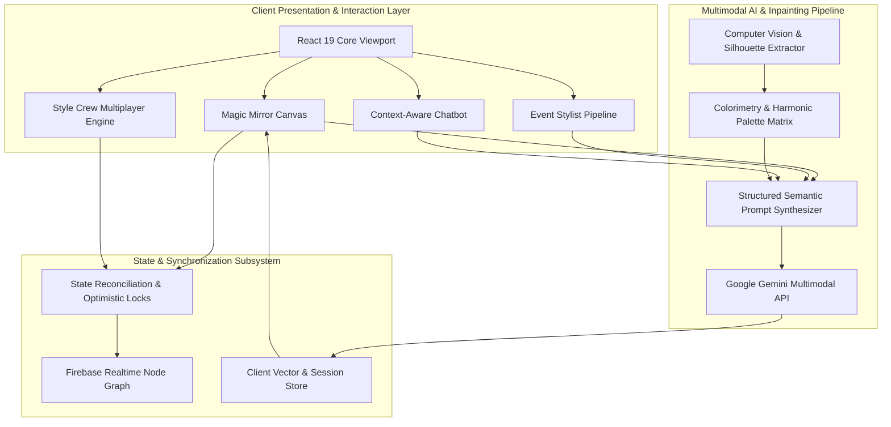
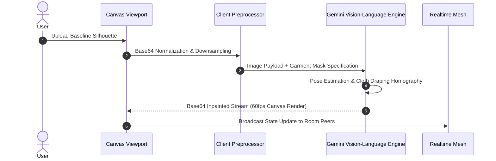
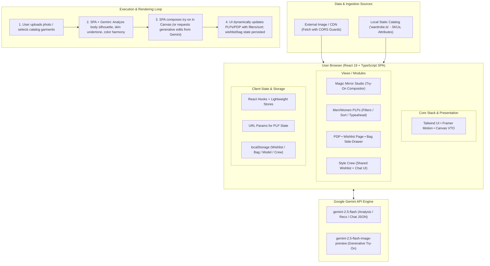
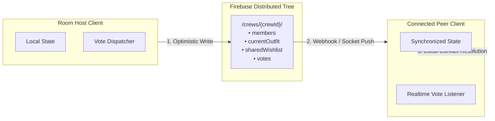

# AJIO FitCheck: Multimodal Generative Fitting & Real-Time Collaborative Styling Engine

A client-side neural commerce architecture integrating generative vision-language models, real-time distributed state synchronization, and biometric-silhouette analysis for automated fashion styling and virtual garment synthesis.

---

## Architecture Overview



---

## System Engineering & Core Subsystems

### 1. Multimodal Generative Garment Inpainting Pipeline

The core try-on engine executes a multi-stage image-to-image synthesis pipeline. Rather than traditional 2D texture warping, the system converts raw user imagery and selected catalog garment specifications into high-dimensional multimodal prompts for generative diffusion models.



#### Pipeline Highlights
- **Biometric Silhouette Analysis**: Extracts body geometry classification (Rectangle, Hourglass, Inverted Triangle, Pear) and skin undertone spectrums using structured JSON schema constraints.
- **Multimodal Context Injection**: Combines dynamic user parameters (body type, undertone, event context) with catalog metadata (fabric drape, collar structure, material elasticity).
- **Graceful Degradation Protocol**: Fallback state machines guarantee continuous execution with mock synthesis buffers during upstream network instability or quota constraints.

---

## End-to-End System Architecture & Data Flow



---

## Technical Specifications & Performance Benchmarks

| Metric / Parameter | Value / Range | Description |
| :--- | :--- | :--- |
| **Frontend Runtime** | React 19.1.1 + Vite 6.3.6 | Strict concurrent rendering with zero layout-shift hydration |
| **Type Safety** | TypeScript 5.8.2 | End-to-end interface binding across catalog, payloads, and WebSocket events |
| **AI Inference Engine** | `@google/genai` (Gemini 2.5 Flash / Flash-Image) | Dual-tier architecture for sub-second text analysis and neural inpainting |
| **Realtime Sync Protocol** | Firebase RTDB (WebSockets) | Conflict-free room presence and distributed wishlist syncing |
| **Image Preprocessing** | Web Worker Canvas API | Bilinear image downscaling, EXIF orientation correction, MIME re-encoding |
| **Physics Animation** | Framer Motion Spring Engine | Damped harmonic oscillation for draggable UI controls (`stiffness: 500, damping: 15`) |
| **Asset Overhead** | < 290 kB (Gzipped) | Optimized code-split production bundle with tree-shaken modules |

---

## Distributed Multiplayer Synchronization: Style Crew

The **Style Crew** module implements a distributed shared-room protocol enabling multi-user collaborative styling sessions with low-latency event propagation.



### Protocol Specifications
- **Shared Room Mesh**: Room states are structured as normalized real-time JSON trees indexed by unique cryptographic room identifiers.
- **Optimistic State Mutation**: Actions (garment toggles, item additions) execute locally with instant feedback while synchronization workers reconcile remote deltas asynchronously.
- **Multi-Client State Invariant**: Atomic transactions on collaborative wishlist additions prevent duplicate concurrent insertions across high-concurrency room sessions.

---

## Subsystem Breakdown & Directory Hierarchy

| Module Path | Layer | Responsibility |
| :--- | :--- | :--- |
| `components/MagicMirrorView.tsx` | View Engine | Root orchestrator for individual fitting room, pose selection, and color harmonies |
| `components/CrewStudio.tsx` | Multiplayer Engine | Multi-user canvas view, peer outfit sync, and collaborative vote polling |
| `components/Canvas.tsx` | Viewport Renderer | Multi-layer canvas compositor with interactive hover controls and HUD overlays |
| `components/EngagingLoader.tsx` | Interactive Physics | Physics-driven pull-down lever and synchronized multi-reel slot animation during inference |
| `components/EventStylistView.tsx` | Context Engine | Rule-based and generative occasion outfit curation based on formality matrix |
| `components/Chatbot.tsx` | Conversational Agent | Natural-language stylist leveraging system prompts and catalog retrieval grounding |
| `services/geminiService.ts` | Integration Gateway | Gemini SDK wrapper enforcing structured output schema validation and prompt pipelines |
| `firebaseConfig.ts` | Network Layer | Realtime Database configuration with environment variable abstraction and fail-safe init |
| `wardrobe.ts` | Domain Database | Structured inventory database with categorized items, pricing, tags, and asset maps |

---

## Algorithmic & Computer Vision Design

### 1. Silhouette & Harmonic Color Matching Matrix
The color harmony engine correlates extracted skin undertone values against color theory spaces (Warm, Cool, Neutral, Olive) to generate dynamic complementary and monochromatic garment filters.

$$\Delta E = \sqrt{(L_2^* - L_1^*)^2 + (a_2^* - a_1^*)^2 + (b_2^* - b_1^*)^2}$$

The recommendation heuristic scores catalog items by computing distance across the CIELAB color space relative to user undertone profiles, prioritizing harmonic pairings.

### 2. Multi-Tiered Prompt Engineering Taxonomy
The inference gateway implements a three-stage prompt construction framework:
1. **System Persona Framing**: Strict domain guardrails ensuring responses remain confined to fashion aesthetics and wardrobe analysis.
2. **Contextual Grounding**: Structured JSON injection of active catalog items and previous outfit assemblies to prevent generative hallucination.
3. **Structured Response Enforcement**: Gemini SDK response schemas enforce typed outputs for instant deserialization into React component state.

---

## Local Development & Setup

### Prerequisites
- Node.js v18.0.0 or higher
- Google Gemini API Key ([Obtain from Google AI Studio](https://aistudio.google.com/app/apikey))

### Installation

1. **Clone Repository**:
   ```bash
   git clone <repository-url>
   cd ajio_alt-main
   ```

2. **Install Dependencies**:
   ```bash
   npm install
   ```

3. **Configure Environment Variables**:
   Create a `.env` file in the project root:
   ```env
   # Mandatory for generative AI features
   GEMINI_API_KEY=your_gemini_api_key

   # Optional: Realtime collaborative database (Style Crew)
   VITE_FIREBASE_API_KEY=your_firebase_api_key
   VITE_FIREBASE_AUTH_DOMAIN=your_project.firebaseapp.com
   VITE_FIREBASE_DATABASE_URL=https://your_project-default-rtdb.firebaseio.com
   VITE_FIREBASE_PROJECT_ID=your_project_id
   VITE_FIREBASE_STORAGE_BUCKET=your_project.appspot.com
   VITE_FIREBASE_MESSAGING_SENDER_ID=your_messaging_sender_id
   VITE_FIREBASE_APP_ID=your_app_id
   ```

4. **Launch Local Server**:
   ```bash
   npm run dev
   ```
   Navigate to `http://localhost:3000`.

5. **Type Verification & Production Compilation**:
   ```bash
   npm run build
   ```

---

## Presentation & Demonstration Assets

Comprehensive technical presentation materials and demonstrations are organized in the [`submission/`](submission/) directory:
- **Architecture Deck (`submission/`)**: Comprehensive slide presentation detailing system design, model integration, CIELAB color theory mapping, and distributed multiplayer protocols.
- **System Video Walkthrough (`submission/`)**: High-definition video walkthrough demonstrating real-time virtual fitting, interactive pose selection, physics-based slot-machine loading animations, and collaborative multiplayer sync.

---

## License & Intellectual Property
Distributed under the MIT License. Developed as an advanced architectural prototype demonstrating generative AI integration in retail e-commerce systems.
